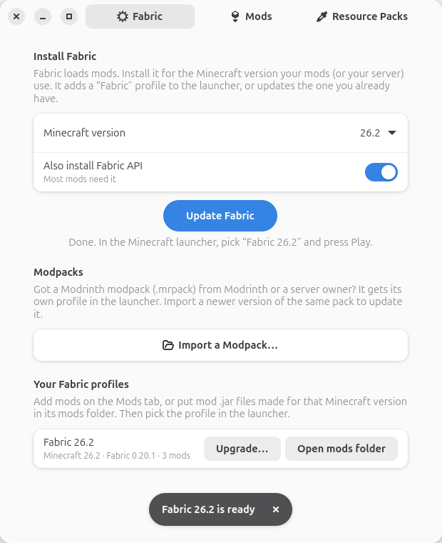
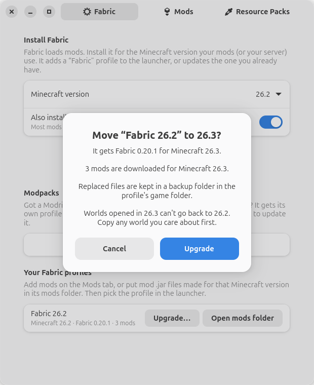
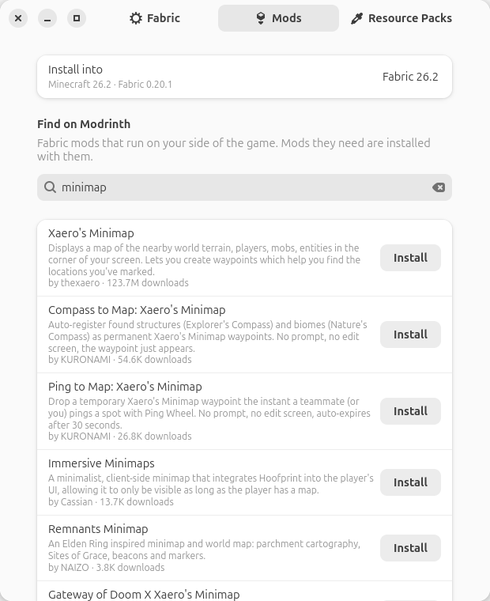
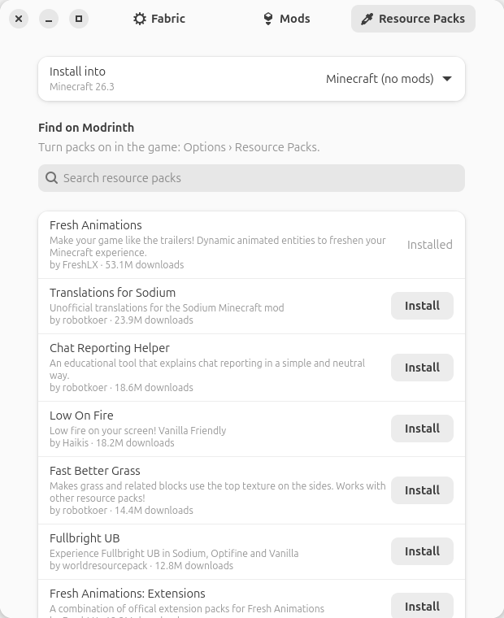

# MC-INSTALLER

## Installation
`sudo snap install mc-installer`

### Microphone (voice chat mods)
Microphone access is not connected automatically. To use voice chat mods such as Simple Voice Chat, run:

`sudo snap connect mc-installer:audio-record`

### Mods, resource packs and modpacks
Mods need a mod loader; putting `.jar` files in the mods folder isn't enough on its own. The snap includes an app called **MC Mods** (also in the right-click menu of the Minecraft icon, as *Set Up Mods*), or run:

`mc-installer.mods`

**Fabric tab**

1. Close the Minecraft launcher.
2. Pick the Minecraft version your mods (or your server) use, and press **Install Fabric**. Fabric API, which most mods need, is installed too.
3. In the launcher, pick the **Fabric** profile and press Play.

A new Fabric profile gets its own game folder (`~/snap/mc-installer/current/.minecraft/profiles/fabric-<version>/`), with its own mods, settings and worlds, so mods for one Minecraft version never load on another. Already have Fabric for that version (from Fabric's own installer, say)? The app finds it, shows its mods, and updates it in place instead of making a second one.

New Minecraft out? Press **Upgrade…** on a Fabric profile and pick the version. The app checks which of its mods have a build for that version (and what new mods they need), shows you, and then moves the profile over: Fabric, mods and resource packs together. Mods that can't come along yet, and every replaced file, go to a backup folder in the profile. Pick the profile's own version to just update all its mods.

Have a Modrinth modpack (`.mrpack`)? Press **Import a Modpack…**. It gets its own profile and game folder, with the Fabric version the pack asks for. Import a newer version of the same pack to update it; your worlds and settings stay.

**Mods tab** (from 16.2)

Pick a Fabric profile, search [Modrinth](https://modrinth.com), and press **Install**. Only Fabric mods that have a build for that profile's Minecraft version and run on the player's side are shown. Mods a mod needs are installed with it. Installing a mod again updates it. The **Installed** list shows every mod in the profile (wherever it came from) with a button to remove it.

**Resource Packs tab** (from 16.2)

The same, for resource packs. They can go in a Fabric profile or in the normal game (*Minecraft (no mods)*). After installing one, turn it on in the game: **Options › Resource Packs**.

Everything is downloaded from Modrinth's own servers (`cdn.modrinth.com`) and checked against Modrinth's checksum before it's used.

Playing on a server with mods? Install Fabric for the server's Minecraft version, then add the mods the server owner says players need (or import the modpack they give you). More help is on the [wiki](https://github.com/kz6fittycent/mc-installer/wiki/Mods).

## About
A fork of the Minecraft-NSG installer snap. Omits the Oracle version of Java and just runs with openjdk. Skips the dialog and just downloads the .jar and runs the installer.

This does not come WITH Minecraft pre-installed. It simply downloads the `.jar` and allows you to play it on your Linux box.

Enjoy!

#### If you like what I'm doing, please consider supporting me on Patreon!

### SPECIAL THANKS TO:

* [galgalesh](https://github.com/galgalesh)
* [popey](https://github.com/popey)
* [tommytran732](https://github.com/tommytran732)
* [kenvandine](https://github.com/kenvandine)

## Star History

